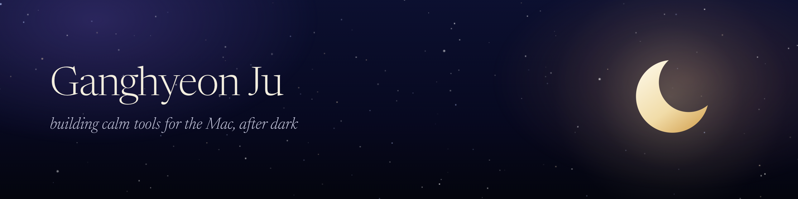

I make the tools I want to use every day, mostly for the Mac.

Right now that's **[Luna](https://luna.orrery.studio)**, a calm, fast code editor with a real terminal inside, the first piece of **[Orrery](https://orrery.studio)**.

### Work

- **[Luna](https://github.com/gk7734/luna)** — a macOS editor built on Zed, with Ghostty's terminal engine and Claude Code and Codex usage in the status bar
- **[beatoraja for Mac](https://github.com/gk7734/beatoraja-for-mac)** — an Apple Silicon port of the BMS player, with a native launcher
- **[CoolCurve](https://github.com/gk7734/CoolCurve)** — a native temperature dashboard and fan curve for the Mac
- **[create-react-web3](https://github.com/gk7734/create-react-web3)** — one command to start a web3 React project

Gimhae, Korea · [orrery.studio](https://orrery.studio)
